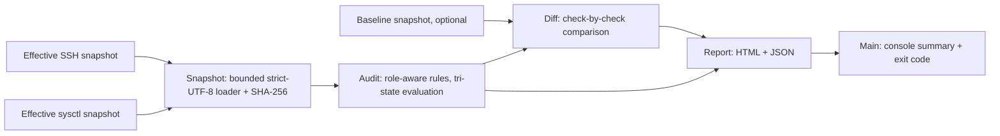

# HostBaseline

[](https://github.com/Mariaax6/hostbaseline/actions/workflows/ci.yml)
[](LICENSE)

**A read-only Linux configuration auditor in Java 17.** It evaluates explicit OpenSSH and sysctl snapshots against a small, role-aware baseline of 24 checks. Every finding keeps the observed value, expected value, severity, rationale, remediation guidance, a documentation reference and a SHA-256 evidence fingerprint. An optional baseline snapshot shows which checks changed.

Runs on Windows, Linux or macOS with no external libraries. It reads the text files you give it; it does not connect to hosts, collect credentials, execute commands or modify system settings.

[Español](README.es.md) · [Example report](https://mariaax6.github.io/hostbaseline/demo/report.html) · [All checks](docs/CHECKS.md) · [Changelog](CHANGELOG.md)

## Quick start

Download `hostbaseline.jar` from the [releases page](https://github.com/Mariaax6/hostbaseline/releases) (a `.sha256` file is published next to it), or build it with a JDK 17+:

```sh
sh build.sh                      # Linux/macOS: compile, test, package
```
```powershell
.\build.ps1 -JdkHome 'C:\Program Files\Java\jdk-21'   # Windows
```

Then audit the bundled synthetic examples:

```sh
java -jar dist/hostbaseline.jar examples/risky reports/risky --baseline examples/hardened
```

Sample console output:

```text
HostBaseline 2.0.0 | role=workstation | input=risky
PASS=11 FAIL=13 UNKNOWN=0 CHANGED=14
FAIL    SSH-01  permitrootlogin: observed yes, expected no
FAIL    SSH-07  maxauthtries: observed 8, expected between 1 and 4
FAIL    NET-05  net.ipv4.conf.all.rp_filter: observed 0, expected 1 or 2
...
Report: /path/to/reports/risky/report.html
```

The risky example intentionally exits **1**, meaning failed policy checks. This is expected, not a crash. Open `reports/risky/report.html`, or inspect `reports/risky/findings.json`. `sh demo.sh` (or `.\demo.ps1`) runs every example and asserts the exit codes.

| Example | Command | PASS | FAIL | UNKNOWN |
|---|---|---:|---:|---:|
| `risky` (14 changes vs `hardened`) | `examples/risky reports/risky --baseline examples/hardened` | 11 | 13 | 0 |
| `hardened` | `examples/hardened reports/hardened` | 24 | 0 | 0 |
| `incomplete` | `examples/incomplete reports/incomplete` | 2 | 0 | 22 |
| `router`, role `router` | `examples/router reports/router --role router` | 24 | 0 | 0 |
| `router`, role `workstation` | `examples/router reports/router-ws` | 23 | 1 | 0 |

All examples are **synthetic** selected outputs; they do not describe a live Linux server. Passing every check only means those 24 policy conditions match this baseline.

## CLI

```text
java -jar hostbaseline.jar <snapshot-dir> <report-dir> [options]

  --role workstation|router   Baseline role (default: workstation)
  --baseline <dir>            Previous snapshot directory to compare against
  --list-checks               Print the checks for the selected role and exit
  --version                   Print the version and exit
  -h, --help                  Show help
```

Each snapshot directory contains:

- `sshd-effective.txt`: effective OpenSSH server settings from `sshd -T` for a documented user/host/address context.
- `sysctl-effective.txt`: `key = value` runtime settings from `sysctl -a` or selected keys.

For an owned Linux lab VM, these are **manual read-only collection examples**, not commands run by this program:

```sh
mkdir -p snapshot
sudo sshd -T -C user=lab,host=lab.example,addr=192.0.2.5 > snapshot/sshd-effective.txt
sysctl -a > snapshot/sysctl-effective.txt 2> snapshot/sysctl-errors.txt
```

Replace the SSH context with the one being assessed, inspect collection errors, and keep a separate note of collection time, host role and context. Keep unrelated sensitive data out of public repositories.

**Do not supply raw `sshd_config`.** `Include` and `Match` need server/context evaluation and defaults depend on the OpenSSH version. The reader rejects obvious Include/Match syntax but cannot prove a file came from `sshd -T`; provenance is the collector's responsibility. A SHA-256 hash identifies input bytes, not their authenticity or freshness.

**Files must be UTF-8.** On Windows PowerShell, `>` writes UTF-16; the tool detects this and asks you to re-export instead of misreading the file.

## Status and exit codes

- `PASS`: explicit, unambiguous value matches the baseline.
- `FAIL`: explicit, unambiguous value differs from the baseline.
- `UNKNOWN`: file or key absent, empty relevant value, conflicting duplicate values, or a value that cannot be interpreted (for example a non-numeric `MaxAuthTries`). The finding states the reason.

Identical duplicates are accepted; conflicting duplicates never silently choose a winner. SSH keys and all values are case-insensitive; sysctl keys keep their spelling. Snapshot files are limited to 4 MiB.

Exit codes: **0** all checks pass · **1** one or more fail · **3** unknown evidence without failures · **2** invalid input, I/O failure or usage error. Failure takes precedence over unknown. JSON keeps every status so automation can apply its own policy. Reusing an output directory replaces its generated report files.

## Policy scope

24 checks: 12 for OpenSSH (root login, password and keyboard-interactive authentication, empty passwords, public keys, X11 and TCP forwarding, authentication attempts, host-based authentication, user environment, login grace time, log level), 7 network sysctls (IPv4 forwarding, SYN cookies, source routing, reverse-path filtering, ICMP redirects, broadcast echo) and 5 kernel/filesystem sysctls (ASLR, kernel pointer and dmesg restriction, protected symlinks and hardlinks). The full table is in [docs/CHECKS.md](docs/CHECKS.md).

The forwarding expectation is `0` for a workstation and `1` for a router; every other check is identical in both roles.

This is an opinionated **key-based SSH baseline**, not a universal hardening standard, and it does not claim conformance with CIS, STIG or any other benchmark. Keyboard-interactive authentication can be necessary for MFA, and disabling authentication methods before verifying key and recovery access can lock out an administrator, so the tool gives review guidance rather than applying fixes.

Source-route, redirect and reverse-path checks examine only the named `all`/`default` keys, not every interface's effective policy. IPv6, firewall rules, patch levels, disk encryption, package vulnerabilities, SSH host keys and user permissions are out of scope. Router forwarding is expected behaviour, not inherently a vulnerability.

## Architecture



| Class | Responsibility |
|---|---|
| `Rule` | Rule definition and matchers (`OneOf`, numeric `Range`) |
| `Snapshot` | Bounded, strict-UTF-8 parsing, duplicate detection, fingerprint |
| `Audit` | The rule set and evaluation to PASS / FAIL / UNKNOWN |
| `Diff` | Drift between a baseline and the current evaluation |
| `Report` | HTML and JSON rendering with escaping |
| `Main` | CLI parsing, console output, exit codes |

Both evaluations in a comparison use the **current** role, so a role change between historical reports is not reconstructed. Evidence hashes are file-level; this is not a signed attestation or a complete configuration diff. Observed-value changes are reported even when both values pass; a changed hash in an unrelated setting does not count as drift.

### JSON output

`findings.json` has `schemaVersion` 2, a `summary` (`changed` is `null` without a baseline) and one object per finding with `id`, `key`, `source`, `status`, `severity`, `observed`, `expected`, `reason`, `evidence {file, sha256}`, `rationale`, `remediation`, `reference` and `drift`.

## Test and extend

`build.sh` / `build.ps1` run the framework-free `Tests` entry point (68 checks): rule integrity, missing evidence, pass/fail/unknown semantics, numeric rules, roles, duplicates, input rejection (Include/Match, malformed, invalid UTF-8, UTF-16, oversize), fingerprints, HTML/JSON escaping, a strict JSON validity check, drift, and every CLI exit code. `demo.sh` then verifies the packaged JAR end to end. CI runs both on Java 17 and 21.

To add a check, follow [CONTRIBUTING.md](CONTRIBUTING.md): stable ID, matcher, rationale, remediation, reference, plus passing and failing fixtures and tests before claiming the check works.

Possible follow-ups, not implemented: a machine-readable custom policy, collection manifests with timestamps and context, per-interface coverage, SARIF output and a Linux VM integration lab.

## Opening in an IDE

Open this directory in IntelliJ IDEA or import `pom.xml` in NetBeans with JDK 17+. The POM is optional IDE metadata and may download Maven plugins; the scripts above are the offline build and verification path. `mvn test` does not run the custom test entry point, so use `build.sh` / `build.ps1`.

## Author

Developed by Maria ([@Mariaax6](https://github.com/Mariaax6)). Released under the [MIT License](LICENSE).

## References

- [OpenSSH sshd_config semantics](https://man.openbsd.org/sshd_config.5) · [sshd command](https://man.openbsd.org/sshd.8)
- [Linux IPv4 sysctl](https://docs.kernel.org/networking/ip-sysctl.html) · [kernel sysctl](https://docs.kernel.org/admin-guide/sysctl/kernel.html) · [fs sysctl](https://docs.kernel.org/admin-guide/sysctl/fs.html)
