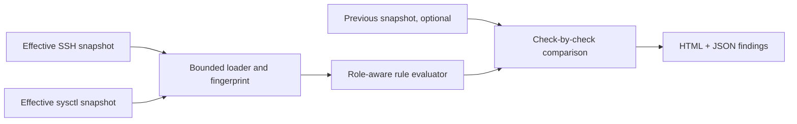

# HostBaseline

**A read-only Linux configuration auditor in Java 17.** Evaluates explicit OpenSSH and sysctl snapshots against a small role-aware baseline. Findings preserve the observed value, expected value, severity, rationale, remediation guidance and SHA-256 evidence fingerprint. Optional comparison identifies changed checks.

Runs on Windows, Linux or macOS without external Java libraries. The tool reads supplied text files; it does not connect to hosts, collect credentials, execute shell commands or modify system settings.

## Try the lab examples

Build with a JDK 17+. From this project directory in PowerShell:

```powershell
.\build.ps1 -JdkHome 'C:\Program Files\Java\jdk-21'
& 'C:\Program Files\Java\jdk-21\bin\java.exe' -jar dist/hostbaseline.jar examples/risky reports/risky workstation examples/hardened
```

Or on Linux/macOS:

```sh
sh build.sh
java -jar dist/hostbaseline.jar examples/risky reports/risky workstation examples/hardened
```

The risky example intentionally exits **1**, indicating failed policy checks. This is expected, not a crash. Open `reports/risky/report.html` or inspect `reports/risky/findings.json`.

| Example | PASS | FAIL | UNKNOWN | Compared changes |
|---|---:|---:|---:|---:|
| risky, compared with hardened | 6 | 6 | 0 | 6 |
| hardened | 12 | 0 | 0 | not compared |
| incomplete | 2 | 0 | 10 | not compared |

All examples are **synthetic** selected outputs; they do not describe this Windows computer or a live Linux server. Passing every check only means those twelve policy conditions match this baseline.

## CLI and input contract

```text
java -jar dist/hostbaseline.jar <snapshot-directory> <report-directory> [workstation|router] [previous-snapshot-directory]
```

Expected filenames in each snapshot directory:

- `sshd-effective.txt`: effective OpenSSH server settings, exported using `sshd -T` for a documented user/host/address context.
- `sysctl-effective.txt`: `key = value` runtime settings, exported with `sysctl -a` or selected keys.

For an owned Linux lab VM, the following are **manual read-only collection examples**, not commands executed by this program:

```sh
mkdir -p snapshot
sudo sshd -T -C user=lab,host=lab.example,addr=192.0.2.5 > snapshot/sshd-effective.txt
sysctl -a > snapshot/sysctl-effective.txt 2> snapshot/sysctl-errors.txt
```

Replace the SSH context with the one being assessed. Inspect collection errors; some values may require privileges or be unavailable. Preserve a separate note of collection time, host role and context. Keep unrelated sensitive data out of public repositories. The auditor reads only the two expected text files.

**Do not supply raw `sshd_config`.** `Include` and `Match` directives require server/context evaluation, and defaults depend on OpenSSH. The reader rejects obvious Include/Match syntax, but cannot prove that a supplied file was produced by `sshd -T`; provenance is the collector's responsibility. A SHA-256 hash identifies input bytes, not their authenticity or freshness.

## Status and exit codes

- `PASS`: explicit, unambiguous value matches the selected baseline.
- `FAIL`: explicit, unambiguous value differs from the baseline.
- `UNKNOWN`: file/key absent, empty relevant value or conflicting duplicate values.

Identical duplicate values are accepted. Conflicting duplicates never silently choose a winning value. SSH keys are case-insensitive; sysctl keys retain their spelling. Snapshot files are UTF-8, maximum 4 MiB each.

Exit codes: **0** all checks pass; **1** one or more fail; **3** unknown evidence without failures; **2** invalid input, I/O failure or usage error. Failure takes precedence over unknown evidence. JSON retains every status so automation can apply its own policy. Reusing an output directory replaces its generated report files.

## Policy scope

Seven SSH checks: root login, password authentication, keyboard-interactive authentication, empty passwords, public-key authentication, X11 forwarding and maximum authentication attempts.

Five Linux checks: IPv4 forwarding, TCP SYN-cookie fallback, source-route acceptance at all/default scope, and ASLR. The forwarding expectation is 0 for a workstation and 1 for a router. The remaining checks are the same in both roles.

This is an opinionated **key-based SSH baseline**, not a universal hardening standard. Keyboard-interactive authentication can be necessary for MFA. Disabling authentication methods before verifying key/recovery access can lock out an administrator. The tool therefore gives review guidance rather than applying fixes.

The source-route checks examine only the named all/default keys; they do not establish every interface's effective network policy. IPv6, firewall rules, patch levels, disk encryption, package vulnerabilities, SSH host keys and user permissions are outside scope. Router forwarding is expected behaviour, not inherently a vulnerability.

## Architecture



`Audit` owns parsing, immutable rule definitions and tri-state evaluation. `Main` formats findings, compares the same rule IDs under the same selected role and maps results to exit codes. Observed-value changes are reported even if both values pass. SHA changes in unrelated settings do not count as checked-setting drift.

Both snapshots in a comparison are evaluated with the **current** role, so a role change between historical reports is not reconstructed automatically. Evidence hashes are file-level; this is not a signed attestation or a complete configuration diff.

## Test and extend

`build.ps1` / `build.sh` run the framework-free `portfolio.hostbaseline.Tests` entry point. Checks cover missing evidence, passing/failing snapshots, role selection, conflicting/identical duplicates, input rejection, fingerprints and HTML/JSON escaping. End-to-end verification additionally checks report JSON, expected process exit codes and drift.

Add checks in `Audit.rules`, with a stable ID, accepted values, rationale and contextual remediation. Add both passing and failing fixtures/tests before claiming the new check works.

Potential follow-ups: a machine-readable custom policy, collection manifests with timestamps/context, per-interface coverage and a Linux VM integration lab. These are future work, not implemented features.

## References

- [OpenSSH sshd_config semantics](https://man.openbsd.org/sshd_config.5)
- [OpenSSH sshd command reference](https://man.openbsd.org/sshd.8)
- [Linux IPv4 sysctl documentation](https://docs.kernel.org/networking/ip-sysctl.html)
- [Linux kernel sysctl documentation](https://docs.kernel.org/admin-guide/sysctl/kernel.html)

## Development provenance

The initial code, lab snapshots and documentation were generated with AI assistance. No real server was audited and no compliance, deployment, individual authorship or measured security-improvement claim is implied. Reproduce and understand the checks, then record your own extensions and experiments before making portfolio claims.

## Opening in an IDE

Open this directory in IntelliJ IDEA or import `pom.xml` in NetBeans. Configure JDK 17+. The POM is optional IDE metadata and may require downloading Maven plugins; the scripts above are the offline build and verification path. `mvn test` does not run the custom framework-free test entry point. Run the provided build script for the documented checks.

## Repository and releases

[Source repository](https://github.com/Mariaax6/hostbaseline) · [Download a release](https://github.com/Mariaax6/hostbaseline/releases)

The verification workflow runs the custom test entry point on Java 17 and 21. A version tag triggers a separate build-and-test workflow which publishes the executable JAR. An example generated report is included under `docs/demo`; download it to view in a browser.
